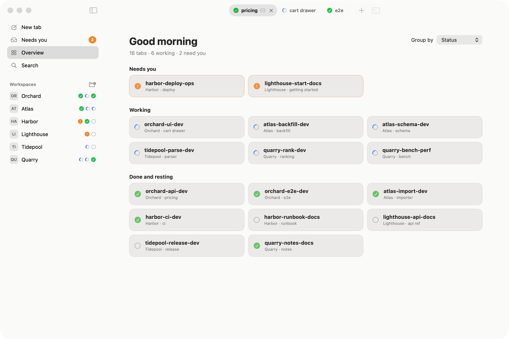
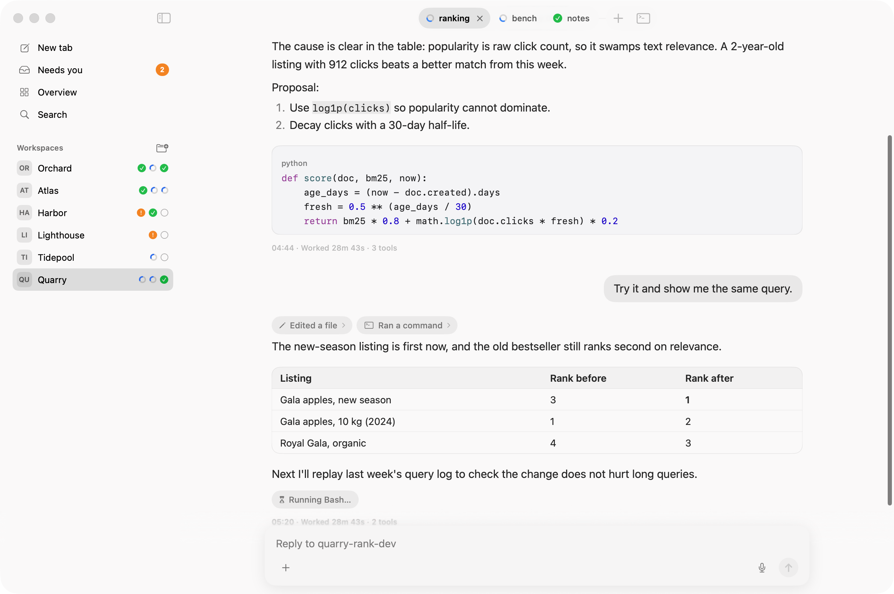
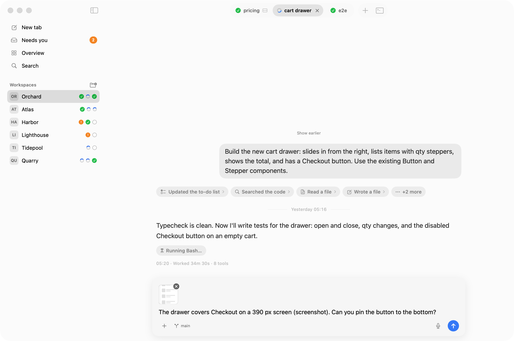
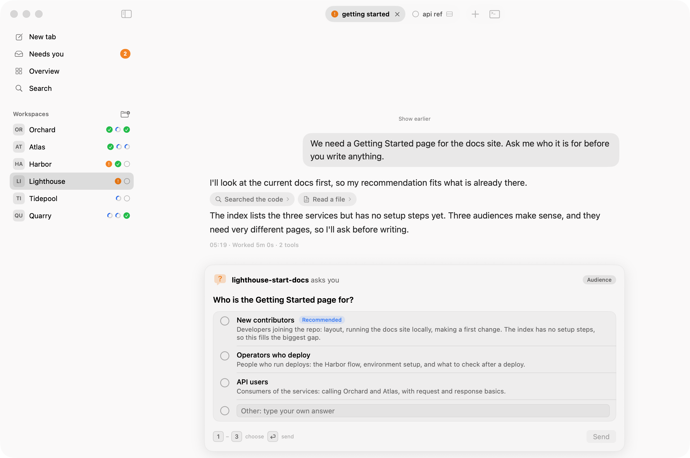
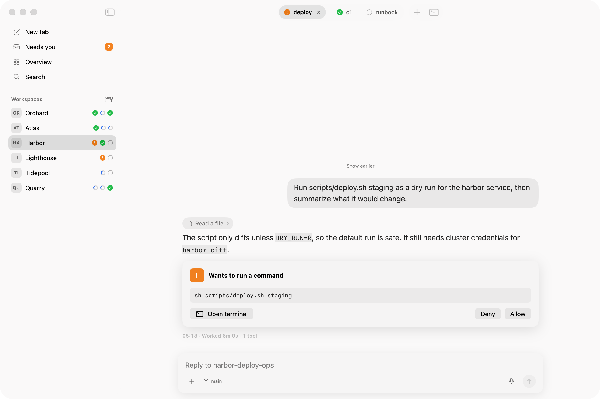
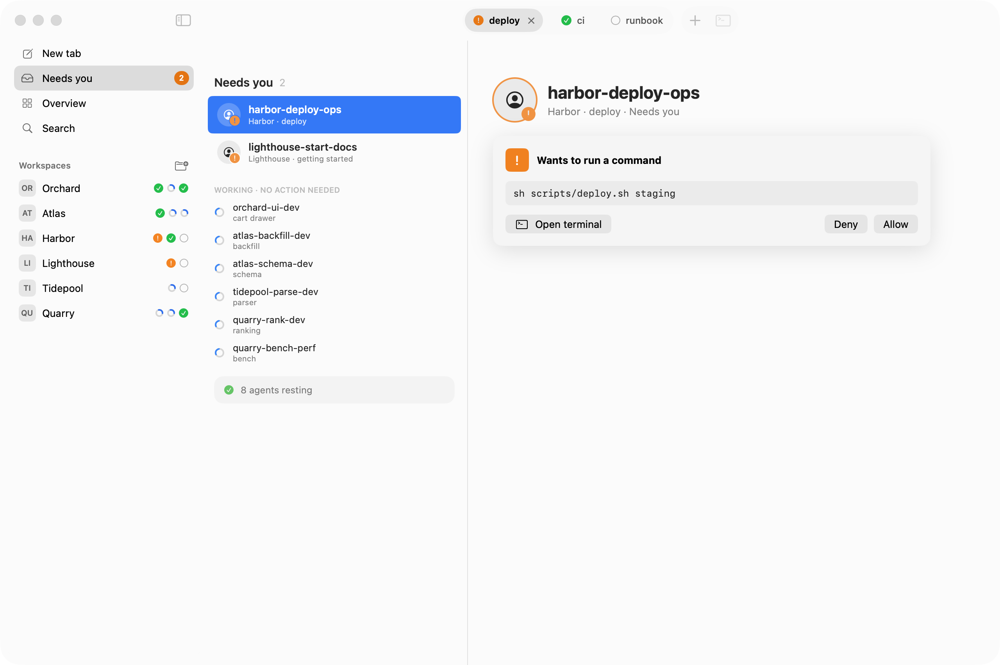
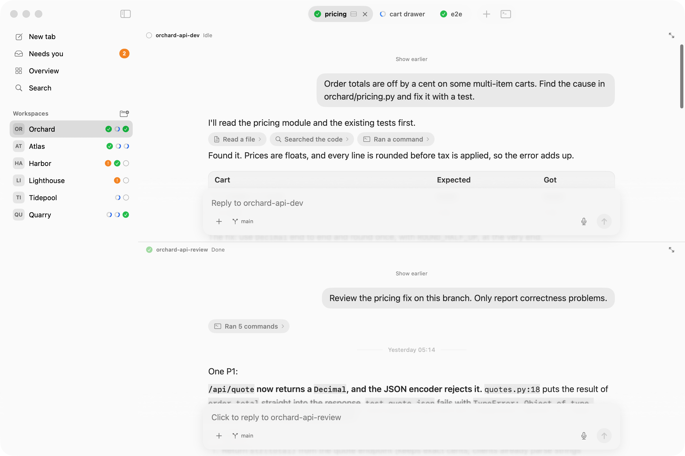
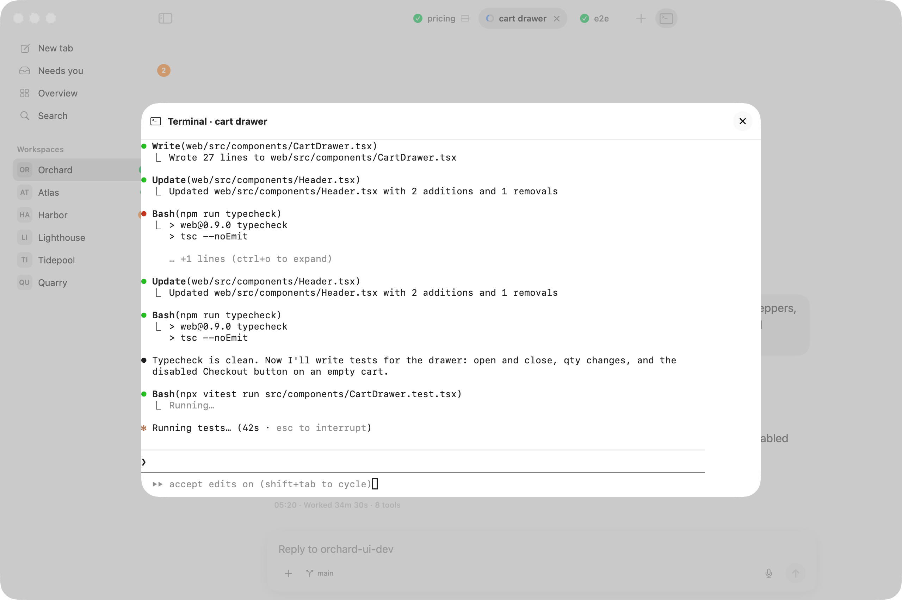

# Flockbook for Herdr

> **Unofficial.** Flockbook is not affiliated with, endorsed by, or supported by Herdr, Inc. It uses only Herdr's public socket API.

Flockbook is a native macOS reading view for your [Herdr](https://herdr.dev) agents. Read what each agent did, see which one needs you, and reply in one place.

Your agents' conversations are already in the terminal. Flockbook shows the same conversation in a layout that is easier to read.

**[Download for macOS](https://github.com/minchenlee/flockbook/releases/latest)** · [Website](https://flockbook.mclee.dev) · Requires macOS 26 or later.

## Features

The screenshots use a fictional demo session (`scripts/demo-seed.sh`).

### Sidebar and overview

The sidebar lists your Herdr workspaces. Overview shows every tab and its state: working, waiting for you, done or idle.

<picture>
  <source media="(prefers-color-scheme: dark)" srcset="docs/media/overview-dark.png">
  
</picture>

### Conversation view

Each agent's session log is shown as a document: Markdown, code, tables, and tool calls folded into short chips.

<picture>
  <source media="(prefers-color-scheme: dark)" srcset="docs/media/conversation-dark.png">
  
</picture>

### Reply

Type under the conversation and press Return to send. You can paste images or attach a file path.

<picture>
  <source media="(prefers-color-scheme: dark)" srcset="docs/media/reply-dark.png">
  
</picture>

### Question card

When an agent asks a question with options, pick an answer from a card.

<picture>
  <source media="(prefers-color-scheme: dark)" srcset="docs/media/question-dark.png">
  
</picture>

### Approval card

When an agent asks for permission, choose Allow or Deny without opening the terminal.
The "needs you" notification shows the command and has the same buttons; on macOS they are under **Options** when you hover over the notification.

<picture>
  <source media="(prefers-color-scheme: dark)" srcset="docs/media/approval-dark.png">
  
</picture>

### Needs you

Agents that wait for you are collected in one list, marked in orange.

<picture>
  <source media="(prefers-color-scheme: dark)" srcset="docs/media/needs-you-dark.png">
  
</picture>

### Split panes

A tab with split panes shows one conversation per pane, stacked.

<picture>
  <source media="(prefers-color-scheme: dark)" srcset="docs/media/split-dark.png">
  
</picture>

### Embedded terminal

Press Control-backtick (⌃`) to see the real terminal of the pane in a sheet.

<picture>
  <source media="(prefers-color-scheme: dark)" srcset="docs/media/terminal-dark.png">
  
</picture>

### Remote access (phone)

Read your agents, and Allow or answer, from your phone. Off by default. Tailscale keeps the page private to your own devices.

1. Install [Tailscale](https://tailscale.com/download) on the Mac and on the phone. Sign in with the same account on both.
2. In the [Tailscale admin console](https://login.tailscale.com/admin/dns), on the DNS page, turn on **MagicDNS** and **HTTPS Certificates**.
3. In Flockbook, open **Settings > Remote access** and turn it on. The checklist shows each step with a tick.
4. Click **Turn On** at "Tailscale Serve". It runs the command it shows (or copy it and run it yourself). It shares only port 7480 with your tailnet, never the internet, and leaves your other Serve settings alone. **Turn Off** removes only that port.
5. Click **Pair a Device** and scan the QR code with the phone. A paired phone can read; turn on input for it in **Devices**.

A phone with input can also send images: tap **+** in the message box (camera or photos, up to 4, 10 MB each). The Mac re-encodes each image (no location or camera data is kept) and stores it in Flockbook's cache folder.

Codex questions can be answered from the phone. Claude Code questions need one more step: at **Answer Claude questions from the phone**, click **Install…**. The sheet shows the exact entry it adds to `~/.claude/settings.json` (a copy of the file is kept first). The hook only tells Flockbook the question; the phone answers only when the picker on screen matches it exactly, else it says to answer on the Mac. Restart running Claude sessions to include them. **Uninstall…** removes only that entry.

**Direct address** (no Tailscale Serve) is under the same setting, marked advanced and less safe: it uses a self-signed certificate that the phone's browser cannot check.

## Requirements

- macOS 26 or later
- Herdr, running
- Agents in Herdr: Claude Code, Codex, Cursor, or pi. Flockbook reads their local session logs to show the conversation.

## Releases

Download the latest `Flockbook-<version>.dmg` or `.zip` from GitHub Releases. Builds are universal (Apple silicon and Intel). Check the download against `SHA256SUMS`.

Release notes say whether a build is signed and notarized. An unsigned build is blocked by macOS on first open; to run it anyway:

```sh
xattr -dr com.apple.quarantine /Applications/Flockbook.app
```

Signed builds update themselves: once a day Flockbook checks for a new release, and it installs one only after you agree (Sparkle; turn the check off in Settings, or use Flockbook > Check for Updates…). Versions up to 0.1.2 have no updater: install the next release by hand once.

## Build

```sh
scripts/bundle.sh    # builds build/Flockbook.app (ad-hoc signed)
scripts/package.sh   # dist/Flockbook-<version>.zip and .dmg
scripts/test-update.sh build/update-test   # headless auto-update check with a throwaway key
```

## Linux and Windows (in progress)

The Rust code in `xplat/` is an early port of Flockbook to Linux and Windows, built with [iced](https://iced.rs). It is not released yet, and it is the reason this repository shows Rust. The macOS app above is the Swift code at the repository root and does not use `xplat/`.

## Privacy

Flockbook runs locally. It reads agent session logs on your Mac (`~/.claude/projects/`, `~/.codex/sessions/`, `~/.cursor/projects/`, `~/.pi/agent/sessions/`) and talks to Herdr through its local socket. It sends nothing over the network and has no telemetry.

## License

MIT. See [LICENSE](LICENSE) and [THIRD_PARTY_NOTICES.md](THIRD_PARTY_NOTICES.md).
